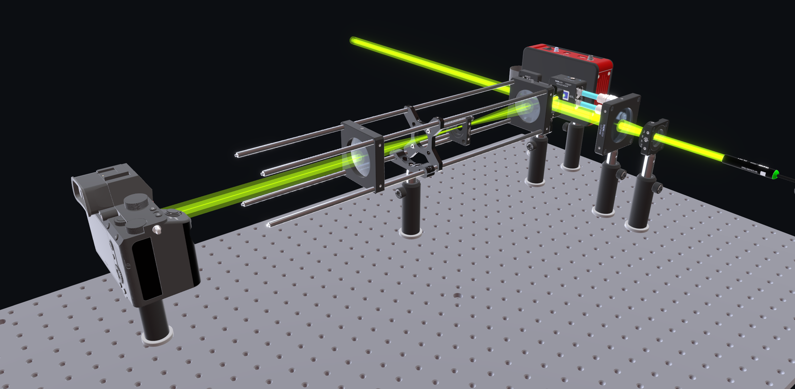

# OpticalTwin

[English](README.md) | **日本語**

<p align="center">
  <picture>
    <source media="(prefers-color-scheme: dark)" srcset="app/public/logo-dark.png">
    <source media="(prefers-color-scheme: light)" srcset="app/public/logo.png">
    
  </picture>
</p>

<p align="center">
  <strong>光学系のレイアウトを、3D で計画・配置・共有する。</strong><br>
  OpticalTwin は、実寸の光学部品と編集可能な OpenUSD シーンを扱う
  ブラウザ上のエディタです。ビームは配置と向きを示す作図上の線です。
</p>

<p align="center">
  <a href="https://github.com/itotlab-system/opticaltwin-core/actions/workflows/ci.yml"></a>
  <a href="https://doi.org/10.5281/zenodo.21594827"></a>
  <a href="https://opensource.org/licenses/Apache-2.0"></a>
  <a href="https://www.python.org/"></a>
  <a href="https://nodejs.org/"></a>
</p>

[](https://drive.google.com/file/d/15PWpWyUp3fIUevIdAOsUyAmhY24BQnxK/view?usp=sharing)

<p align="center">
  <a href="https://drive.google.com/file/d/15PWpWyUp3fIUevIdAOsUyAmhY24BQnxK/view?usp=sharing">▶ デモ動画を見る</a>
</p>

## できること

- 実寸の光学部品をブレッドボード上に配置し、収まり・間隔・アライメントを確認
- ミラーやビームスプリッタでの折り返しを含むビーム経路を、作図として追跡
- グループ化・複製・図注ラベル・画像出力で、議論や論文用の図に
- セットアップをテキスト形式の OpenUSD シーンとして保存し、Git で確認・共有

ブレッドボード上に光学系を組む研究グループが、実験室から離れた場所でレイアウトを
検討・議論するためのツールです。部品は実寸で定義されているため、画面上で収まるものは
実際の定盤上でも収まります。

OpticalTwin は**レイアウトと配置計画**のためのツールであり、光学設計ソフトではありません。
ビームは部品間の作図上の線で、屈折・集光・回折・光線追跡の計算は行いません。光学設計には
Zemax・Code V などがあり、本ツールはブラウザで開いて編集・共有できる軽さに価値があります。

## はじめかた

Python 3.12 と Node 20 が必要です。

```bash
python3.12 -m venv .venv && source .venv/bin/activate
pip install -r requirements-app.txt
python setup_projects.py               # 部品ライブラリとサンプルのベンチを生成
python server.py                       # バックエンド（:8000）

cd app && npm install && npm run dev   # 別ターミナルで。http://localhost:5173 を開く
```

詳しくは [Getting started](docs/getting-started.md)（英語）をご覧ください。

## ドキュメント（英語）

| | |
|---|---|
| [Getting started](docs/getting-started.md) | インストール・起動・自動生成される部品ライブラリ・本番用ビルド |
| [Manufacturer CAD models](docs/cad-models.md) | 手元にある部品の、メーカー提供の STEP モデルを使う（CAD データは同梱していません） |
| [How it works](docs/architecture.md) | USD を唯一の情報源とする仕組み・コード構成・ビームの描き方 |
| [Running it for your lab](docs/deployment.md) | 共有パスワードによるログインと、研究室ネットワークでの運用 |
| [Roadmap](docs/roadmap.md) | 今後の予定 |
| [CONTRIBUTING.md](CONTRIBUTING.md) · [CODE_OF_CONDUCT.md](CODE_OF_CONDUCT.md) | Pull Request の取り込み方（本リポジトリは開発リポジトリからの書き出しです）・テストの実行・参加にあたっての行動規範 |
| [CHANGELOG.md](CHANGELOG.md) · [SECURITY.md](SECURITY.md) | 変更履歴・セキュリティ方針 |

## 引用

4 名の著者は等しく貢献しています。研究で使用した場合は、[README の Citation 節](README.md#citation)
の形式、または `CITATION.cff` を参照して引用してください。DOI は
**10.5281/zenodo.21594827** です（Concept DOI のため、常に最新版を指します）。

## ライセンスと謝辞

ライセンスは [Apache 2.0](LICENSE) です。千葉大学 大学院工学研究院
[伊藤・下馬場・王 研究室（ITOT lab.）](https://sites.google.com/view/ito-shimobaba-lab/home)
にて開発されました。
