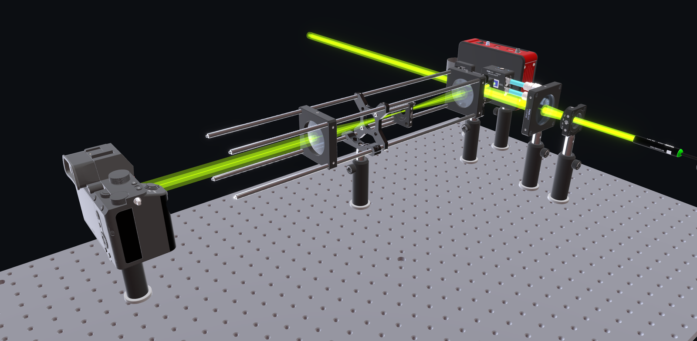

# OpticalTwin

**English** | [日本語](README.ja.md)

<p align="center">
  <picture>
    <source media="(prefers-color-scheme: dark)" srcset="app/public/logo-dark.png">
    <source media="(prefers-color-scheme: light)" srcset="app/public/logo.png">
    
  </picture>
</p>

<p align="center">
  <strong>Plan, arrange, and share optical bench layouts in 3D.</strong><br>
  OpticalTwin is a browser-based editor for real-sized optical components and
  editable OpenUSD scenes. Beam paths show geometric layout and direction.
</p>

<p align="center">
  <a href="https://github.com/itotlab-system/opticaltwin-core/actions/workflows/ci.yml"></a>
  <a href="https://doi.org/10.5281/zenodo.21594827"></a>
  <a href="https://opensource.org/licenses/Apache-2.0"></a>
  <a href="https://www.python.org/"></a>
  <a href="https://nodejs.org/"></a>
</p>

[](https://drive.google.com/file/d/15PWpWyUp3fIUevIdAOsUyAmhY24BQnxK/view?usp=sharing)

<p align="center">
  <a href="https://drive.google.com/file/d/15PWpWyUp3fIUevIdAOsUyAmhY24BQnxK/view?usp=sharing">▶ Watch the demo video</a>
</p>

## What you can do

- Arrange real-sized optical components on a breadboard and check fit, spacing,
  and alignment.
- Follow and fold beam paths geometrically through mirrors and beamsplitters.
- Group, duplicate, label, and export layouts for discussion or figures.
- Save setups as text-based OpenUSD scenes that can be reviewed and shared with
  Git.

It is made for research groups who build setups on breadboards and want to plan
and discuss them away from the bench. OpticalTwin is for **layout and planning**:
beams are geometric guides between components, not an optical simulation.

## Quick start

Requires **Python 3.12** and **Node 20**.

```bash
python3.12 -m venv .venv && source .venv/bin/activate
pip install -r requirements-app.txt
python setup_projects.py               # builds the parts library and an example bench
python server.py                       # backend on :8000

cd app && npm install && npm run dev   # in a second terminal, then open http://localhost:5173
```

See [Getting started](docs/getting-started.md) for the details.

## Documentation

| | |
|---|---|
| [Getting started](docs/getting-started.md) | Install, run, the generated parts library, a production build |
| [Manufacturer CAD models](docs/cad-models.md) | Use real STEP models of the parts you own |
| [How it works](docs/architecture.md) | USD as the source of truth, the code layout, how beams are drawn |
| [Running it for your lab](docs/deployment.md) | The shared-password login and running on a lab network |
| [Roadmap](docs/roadmap.md) | What is planned next |
| [Contributing](CONTRIBUTING.md) · [Code of Conduct](CODE_OF_CONDUCT.md) | How this repository takes pull requests, running the tests, and the standards for taking part |
| [Changelog](CHANGELOG.md) · [Security](SECURITY.md) | Release notes and the security policy |

## Citation

All four authors contributed equally to this work.

If you use OpticalTwin in your research, please cite it as:

> Kumano, K., Yoshino, K., Goto, M., & Matsuo, Y. (2026).
> *OpticalTwin: a browser-based 3D viewer and editor for optical laboratory setups*
> (Version 2.0.0) [Computer software].
> Zenodo. https://doi.org/10.5281/zenodo.21594827

BibTeX:

```bibtex
@software{opticaltwin,
  author  = {Kumano, Kai and Yoshino, Kota and Goto, Masato and Matsuo, Yuto},
  title   = {{OpticalTwin: a browser-based 3D viewer and editor for optical laboratory setups}},
  year    = {2026},
  version = {2.0.0},
  doi     = {10.5281/zenodo.21594827},
  publisher = {Zenodo},
  url     = {https://github.com/itotlab-system/opticaltwin-core}
}
```

See `CITATION.cff` for machine-readable metadata. GitHub renders it as a
"Cite this repository" button. The DOI above is the concept DOI and always
resolves to the latest release, so it stays valid as versions change.

## Licence and acknowledgements

Licensed under [Apache 2.0](LICENSE). Developed at the
[Ito–Shimobaba–Wang Laboratory (ITOT lab.)](https://sites.google.com/view/ito-shimobaba-lab/home),
Graduate School of Engineering, Chiba University.
