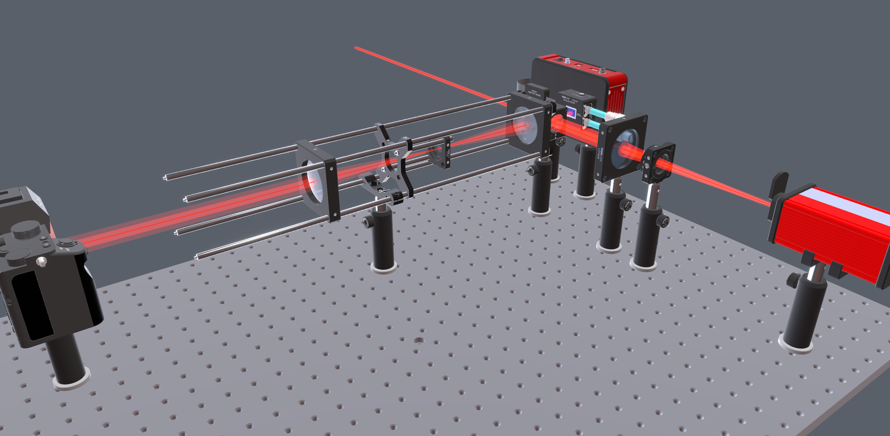
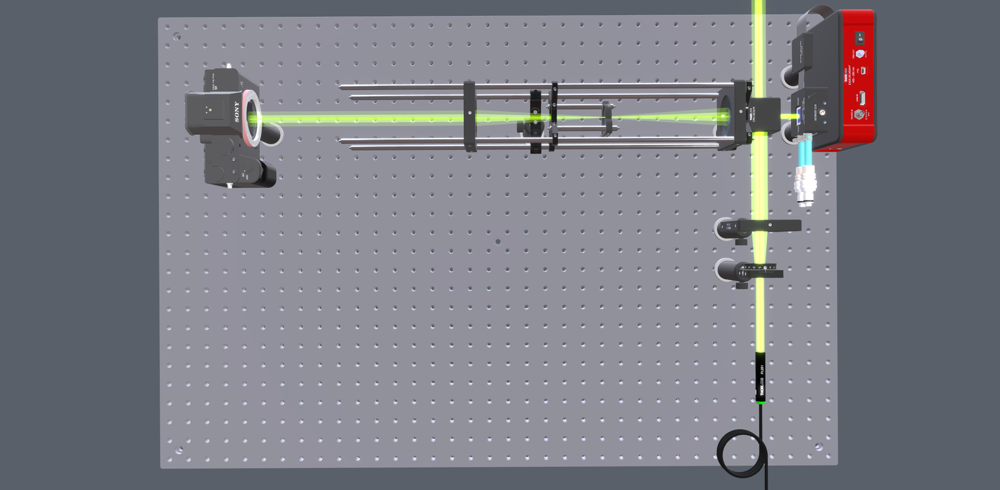

# How it works

[← Back to the README](../README.md)

## USD is the source of truth

Each optic is its own `.usda` asset in `components/`; a setup in
`projects/<name>/setup.usda` pulls them in via USD **References**, so one asset
can be placed many times. Every edit in the browser is written straight back to
the `.usda` file. The editor holds no hidden state, and setups are plain text,
so they diff and merge in git.

Sync between people is plain git: commit `projects/<name>/` and pull each
other's changes. There is no database or lock-in. Setups remain readable USD
files even if OpticalTwin is no longer available.

Scenes use millimetres (`metersPerUnit = 0.001`), Z up, and an optical axis
along +X. Custom attributes use the `optics:` namespace, for example
`optics:focalLength_mm`.

## Code layout

```
OpticalTwin/
├── server.py            # entry point: python server.py
├── backend/             # Flask backend: reads/writes USD, serves the REST API
├── opticaltwin/         # core library, no web code:
│   ├── optics_lib.py    #   component generators and setup helpers
│   ├── templates.py     #   named setup recipes
│   ├── beam_tracer.py   #   straight-line beam path resolution
│   ├── cad_importer.py  #   STEP → USD components (python -m opticaltwin.cad_importer)
│   └── usd_to_web.py    #   setup .usda → .glb (python -m opticaltwin.usd_to_web)
├── setup_projects.py    # scaffolds projects/<name>/setup.usda from a template
├── scripts/             # runnable examples
├── tests/               # Python tests
├── cad/SOURCES.toml     # manufacturer CAD manifest (pointers, no CAD data)
├── tools/fetch_cad.py   # fetches the models listed in that manifest
├── app/                 # React + React Three Fiber frontend
├── web/                 # static viewer / earlier plain-HTML editor
├── components/          # generated component library (not checked in)
└── projects/            # one folder per setup (the live edited state)
```

## How beams are drawn

Beam paths are geometric guides between components. The app does not calculate
refraction, focusing, diffraction, ray tracing, tolerancing, or aberrations.

| | |
|---|---|
|  |  |
| Beam colour follows the source's `optics:wavelength_nm`: a 633 nm source draws red, a 532 nm source green. | Top-down, where spacing and alignment are easiest to judge. |

The 90° turn at the beamsplitter is a **geometric fold**. The tracer reflects the
line off components that change direction and passes it through the ones that do
not. This describes layout geometry, not optical physics.
